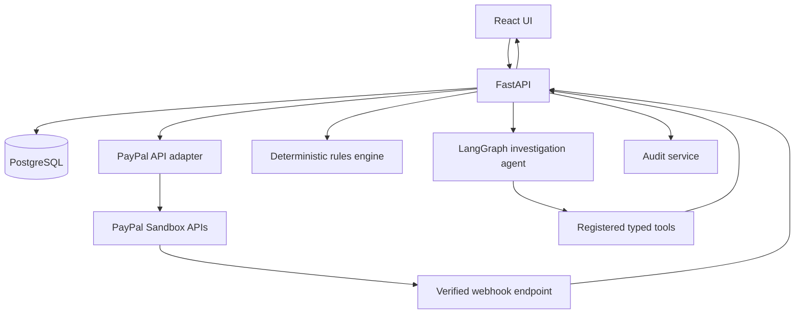

# PayPilot AI — Project Handbook

**Working name:** PayPilot AI
**Concept:** The Payment Detective

## Product summary
PayPilot AI, internally described as **The Payment Detective**, is an AI-assisted payment investigation and safe-resolution system for merchants. It helps merchants understand why an order and payment record disagree, why a payment attempt failed or was cancelled, whether an event was processed more than once, or what the available records say about a refund.

The product is not a generic finance chatbot and not merely a dashboard. Its core workflow is:
**detect or receive an issue → retrieve relevant records → run deterministic checks → explain evidence and uncertainty → recommend a next step → obtain human approval for consequential actions → execute supported action → audit the result.**

## Architecture
- React + TypeScript web client.
- FastAPI application/API layer.
- Authentication and merchant authorization.
- PayPal adapter for server-side Orders and Payments API operations.
- Webhook endpoint and verification service.
- PostgreSQL persistence via SQLAlchemy and migrations.
- Deterministic rules/reconciliation service.
- Investigation service that assembles evidence.
- LangGraph orchestration with registered tools.
- Audit service.
- CSV import service with provenance metadata.
- AG Grid AG Studio UI integration, subject to current SDK verification.

## Main payment flow
1. Client requests checkout for a local order.
2. Backend validates order ownership and amount, creates PayPal order.
3. Client approves using the PayPal JS SDK.
4. Backend captures using server-side credentials.
5. Backend validates response shape and persists capture details.
6. PayPal webhook endpoint receives an event, verifies its signature, stores event ID and payload fields needed for the app, and processes it idempotently.
7. Local state is reconciled using authoritative API responses and verified events; do not assume webhook arrival order.

## Investigation flow
1. User chooses an issue or asks a question.
2. Agent identifies required evidence.
3. Registered tool validates user/merchant scope and retrieves records.
4. Deterministic service compares IDs, status, currency, amount, and event sequence.
5. Agent summarizes findings using tool results only.
6. UI displays evidence references and uncertainties.
7. If action is proposed, create a pending action record; do not execute yet.

## Approved action flow
1. User opens proposed action and sees amount, currency, target capture, reason, and risk.
2. User explicitly approves or rejects.
3. Backend checks role, ownership, action state, eligibility, currency, amount, and idempotency key.
4. Backend calls provider API.
5. Persist provider result and audit event.
6. If provider outcome is ambiguous due to timeout, mark as `outcome_unknown` and reconcile before retrying.

## Data ingestion flow
CSV upload → validate file size/type/columns → preview rows → show errors → merchant confirms → normalize fields → deduplicate using documented source keys → store source/provenance → run matching rules. CSV data must never be relabelled as provider-verified.

## Mermaid overview

## MVP requirements
- FR-01: Authentication and merchant-scoped workspace.
- FR-02: Create a local order and PayPal Sandbox order from the backend.
- FR-03: Complete buyer approval and capture using the PayPal flow.
- FR-04: Persist local order and payment attempt with provider IDs and provenance.
- FR-05: Receive, verify, store, and idempotently process supported webhooks.
- FR-06: List/search/filter orders, payments, and investigations.
- FR-07: Show a payment timeline and source/trust labels.
- FR-08: Run deterministic rules for selected mismatch cases.
- FR-09: Allow a user to ask an investigation question in natural language.
- FR-10: AI calls only registered backend tools and returns structured findings.
- FR-11: Findings include evidence references, known facts, uncertainties, and recommended next step.
- FR-12: Prepare and approve a supported refund with authorization and eligibility checks.
- FR-13: Record investigation and sensitive action audit events.
- FR-14: Import external records through documented CSV templates with preview and validation.
- FR-15: Clearly separate sandbox, API-verified, imported, and fixture records.
- FR-16: Show useful empty, loading, failure, and retry states.

## Non-functional requirements
- Security: secrets stay server-side; all records are merchant-scoped.
- Reliability: idempotent webhook processing; safe handling of duplicate requests and provider timeouts.
- Auditability: sensitive actions have actor, time, target, decision, and outcome.
- Explainability: AI claims map to stored evidence references.
- Usability: an issue should be understandable without reading raw logs.
- Maintainability: provider adapters, rules, and AI tools are modular.
- Portability: local development and documented deployment.
- Accessibility: keyboard-operable controls, readable contrast, labelled forms.

## Acceptance criteria
A reviewer can:
1. Configure Sandbox credentials using `.env`.
2. Start the application following the README.
3. Sign in using documented demo instructions.
4. complete a Sandbox checkout and see a persisted order/payment.
5. See webhook processing status without duplicate event side effects.
6. open an issue and inspect its timeline.
7. ask the AI to investigate it and receive evidence-grounded output.
8. review/approve a supported test refund and see the result/audit record.
9. run automated tests and distinguish any tests requiring credentials.

## Data model
### merchants
- id (UUID primary key)
- name
- default_currency (optional; never assume all records use it)
- created_at

### users
- id, merchant_id, email, password_hash or identity-provider subject, role, created_at, disabled_at

### orders
- id (UUID), merchant_id, source_type, external_order_id, currency, total_amount, status, created_at, updated_at, provenance, metadata_json
- Unique key should prevent duplicate source order IDs within the appropriate merchant/source scope.

### payment_attempts
- id, merchant_id, order_id, provider, provider_order_id, capture_id, currency, amount, status, provider_status, created_at, updated_at, provenance, last_verified_at
- Do not assume one order has only one attempt.

### provider_events
- id, merchant_id, provider, provider_event_id, event_type, event_time, received_at, verification_status, processing_status, payload_minimized_json
- Unique provider event ID per provider/account scope. Store only the fields required for operation/audit.

### investigations
- id, merchant_id, created_by, issue_type, status, title, order_id, payment_attempt_id, priority, opened_at, resolved_at

### investigation_findings
- id, investigation_id, finding_type, severity, summary, evidence_refs_json, facts_json, uncertainties_json, recommendation, created_at, model_version (optional)

### proposed_actions
- id, merchant_id, investigation_id, action_type, target_capture_id, currency, amount, reason, status, proposed_by, approved_by, approved_at, executed_at, provider_request_id, idempotency_key, outcome_json

### audit_events
- id, merchant_id, actor_user_id (nullable for system events), action, target_type, target_id, timestamp, outcome, correlation_id, details_redacted_json

### imports and imported_records
Track uploaded file metadata, source label, uploader, import time, validation result, row count, and row-level source references. Treat imported rows as unverified until independently matched.

## Money and timestamps
- Use Decimal or integer minor units with explicit currency metadata.
- Validate currency precision and provider-supported currencies.
- Store timestamps in UTC; render in user locale.
- Never sum different currencies without an explicit conversion policy and exchange-rate provenance.

## Connector interface
Create a provider-neutral interface such as:
- `create_order(...)`
- `capture_order(...)`
- `get_order(...)`
- `get_capture(...)`
- `refund_capture(...)`
- `verify_webhook(...)`
- `normalize_event(...)`

Implement PayPal first. Marketplace/store adapters should be added independently. CSV is an ingestion adapter, not a live API integration.

## CSV import requirements
- Publish templates and sample files marked as examples.
- Validate required columns and supported values.
- Preview before committing.
- Preserve original source row number and external IDs.
- Reject or report malformed amounts/currencies/dates.
- Deduplicate repeat imports safely.
- Clearly label imported records in UI and AI evidence.
- Never treat a matching amount alone as proof two records are the same transaction.

## AI agent
1. `get_order_details(order_id)`
2. `get_payment_details(payment_attempt_id or provider reference)`
3. `get_event_timeline(order_id/payment_attempt_id)`
4. `compare_order_payment(order_id, payment_attempt_id)`
5. `find_related_records(query filters with strict bounds)`
6. `run_payment_rules(order_id/payment_attempt_id)`
7. `get_investigation_summary(investigation_id)`
8. `prepare_resolution(investigation_id, action_type, parameters)` — creates a pending proposal only; never executes a payment operation.

Tools must validate arguments and access scope. Do not expose arbitrary SQL or raw ORM query generation to the model.

## Agent output schema
Return structured output such as:
- `summary`: concise explanation.
- `issue_type`: controlled enum.
- `facts`: list of fact + evidence reference.
- `uncertainties`: list.
- `recommendation`: next step.
- `proposed_action`: optional pending proposal ID.
- `confidence`: optional calibrated qualitative label, not a guarantee.
- `needs_human_review`: boolean.

Every factual statement about a transaction must reference returned tool evidence. If tools fail or data is unavailable, say so.

## Agent orchestration
Use LangGraph for bounded steps:
1. Parse the user's question/issue.
2. Select relevant tools.
3. Execute tools with validated arguments.
4. Evaluate whether sufficient evidence exists.
5. If needed, call another allowed tool with a bounded iteration count.
6. Produce a structured evidence-grounded response.
7. Persist investigation finding and audit metadata.

## Financial safety
The agent cannot approve actions, change roles, bypass checks, call arbitrary URLs, access secrets, or issue refunds directly. Refund execution is a separate backend endpoint requiring authenticated authorization, explicit approval, revalidation, and idempotency protection.

## Integrations and sponsors
- Use the official PayPal Developer Sandbox.
- Create Sandbox business and buyer accounts.
- Configure client ID and secret as backend environment variables.
- Use Orders API for create/capture and relevant Payments API operations for eligible refunds.
- Use the JavaScript SDK for buyer approval.
- Configure webhook event subscriptions that are actually needed by the implemented flow.
- Verify webhook signatures using the supported PayPal verification mechanism.
- Document Sandbox limitations and the exact API paths tested.

## AI
Proposed starting point: Gemini API with LangGraph. Verify current model availability, tool-calling support, terms, limits, and secret management. Keep provider/model access behind an internal agent service so it can be changed later.

## AG Grid AG Studio
Candidate sponsor integration and potential prize target. Check current official documentation, package access, event requirements, and specific prize rules. Build a genuine embedded analytics/investigation experience if feasible. Do not let a sponsor-specific SDK block PayPal and AI core functionality.

## APIMatic
Development support for API understanding/code generation where available. It is not a substitute for testing actual API requests. Follow its current licensing and tool terms.

## Postman
Create a collection for auth, order creation, payment flow, investigation endpoints, imports, and approval actions. Use environment variables without committing credentials. Include expected responses and negative cases.

## Render
Candidate host for frontend/backend. Confirm free-tier availability, sleep behaviour, persistent storage limitations, environment variables, outbound access, and webhook reachability before relying on it. PostgreSQL may be hosted separately (e.g. Supabase) if suitable.

## Marketplace/store connectors
Future connector targets may include Amazon, Flipkart, Shopify, WooCommerce, and other major sources. The MVP must not claim these are live. Start with a generic CSV import format and optional Amazon SP-API Sandbox exploration if time allows and official access is available. Access to a seller account, app registration, permissions, regional availability, and API terms may be required for live data.

## Integration status labels
Every connector must show one of:
- `Connected — Sandbox`
- `Connected — Live` (only after verified live testing and authorization)
- `CSV import`
- `Planned`
- `Unavailable / setup required`

## Sponsor prize caution
Sponsor tool use and sponsor prize eligibility are different. Read the active prize rules and required implementation criteria before making a sponsor-prize claim.

## Security and testing
- Backend-only PayPal client secret and AI API key.
- Password hashing or a well-configured external identity provider.
- Merchant-level data isolation enforced in every query and action.
- Role/permission checks for approvals.
- CSRF/CORS/session strategy appropriate to chosen auth mechanism.
- Request validation, upload limits, rate limiting, and safe error messages.
- Webhook signature verification and event deduplication.
- Idempotency keys and duplicate-action prevention for payment operations.
- Audit trail for approvals, rejects, refunds, imports, and configuration changes.
- Redact secrets and minimize sensitive data in logs.
- Validate imported files and guard against formula injection when exporting CSV.
- Keep dependency versions and secrets out of source control.

## Test plan
### Unit tests
- Currency/amount comparisons.
- Status transition rules.
- Duplicate event detection.
- CSV validation/deduplication.
- Agent output schema and evidence-reference validation.
- Authorization and merchant scoping.
- Proposed-action state machine.

### Integration tests
- PayPal Sandbox order creation/capture with configured credentials.
- Webhook signature verification and duplicate delivery handling.
- Database persistence and migrations.
- AI tool execution against seeded application records.
- Refund request validation and supported Sandbox refund path.

### End-to-end demo test
1. Sign in.
2. Create and approve Sandbox checkout.
3. Confirm payment/capture is persisted.
4. Deliver/process relevant webhook.
5. Open an investigation or create a reproducible mismatch scenario.
6. Ask the AI to investigate.
7. Inspect evidence references and explanation.
8. Prepare and approve a supported Sandbox action, or show a safe recommendation if refund preconditions are not met.
9. Verify audit record and refreshed status.

## Deployment
- Frontend and backend configured with environment variables.
- Managed PostgreSQL with migrations.
- HTTPS and publicly reachable webhook URL for deployed testing.
- Health/readiness endpoints.
- Seed/demo setup that does not create fake PayPal confirmations.
- Document cold starts/sleep limitations if using a free hosting tier.
- Keep a reliable local demo path if hosting is unavailable.

## Required environment template
Include placeholders for:
- `DATABASE_URL`
- `APP_SECRET_KEY`
- `PAYPAL_CLIENT_ID`
- `PAYPAL_CLIENT_SECRET`
- `PAYPAL_BASE_URL` (Sandbox by default)
- `PAYPAL_WEBHOOK_ID`
- `GEMINI_API_KEY`
- `FRONTEND_ORIGIN`
Never put actual credentials in documentation or version control.

## Implementation roadmap
— Repository inspection and setup
- Inspect existing files and preserve reusable work.
- Decide package manager and auth strategy based on existing repository.
- Establish backend/frontend structure, formatting, linting, `.env.example`, and README.
- Deliverable: app starts locally; health endpoint works; database connection configured.

## Phase 1 — Persistence and authentication
- Create migrations and core tables.
- Implement sign-in and merchant-scoped authorization.
- Seed only clearly labelled demo merchant/user records.
- Tests: auth, ownership isolation, migrations.

## Phase 2 — PayPal Sandbox payment
- Configure Sandbox buyer/business accounts.
- Implement server-side order creation, client approval, capture, and persistence.
- Implement webhook verification and idempotent event processing.
- Tests: API integration where credentials are present; unit tests for error paths.

## Phase 3 — Deterministic investigation engine
- Define issue enums and rule checks.
- Implement investigation queue, transaction details, and event timeline.
- Add controlled test scenarios that are labelled and never misrepresented as PayPal events.
- Tests: each rule and provenance handling.

## Phase 4 — AI investigation agent
- Implement typed tool registry and LangGraph flow.
- Use application records and deterministic comparison outputs.
- Validate structured output and evidence references.
- Add bounded loops, timeouts, and model failure handling.
- Tests: tool permissions, insufficient evidence, unsupported question, fabricated-evidence guard.

## Phase 5 — UI and sponsor integration
- Build overview, investigations, payment detail, AI copilot, approval, audit, and integrations screens.
- Verify AG Grid AG Studio current SDK/access and implement actual integration where feasible.
- If unavailable, document blocker and use a clearly separated table/chart fallback without claiming AG Studio usage.
- Test loading/empty/error states and keyboard interaction.

## Phase 6 — Approved actions
- Implement proposal/approve/reject state machine.
- Add eligible Sandbox refund flow only after verifying official API requirements.
- Revalidate role, ownership, payment state, amount, currency, and idempotency before execution.
- Record audit and provider outcome.

## Phase 7 — Imports, polish, deployment
- Add CSV template, preview, validation, import history, and source labels.
- Deploy with HTTPS and reachable webhook URL.
- Run end-to-end demo and regression tests.
- Publish setup guide, license, and demo script.

## Scope rule
The PayPal Sandbox investigation journey takes priority over marketplace API breadth. If time is short, postpone marketplace connectors and advanced charts rather than compromising payment correctness, AI evidence grounding, or demo reliability.