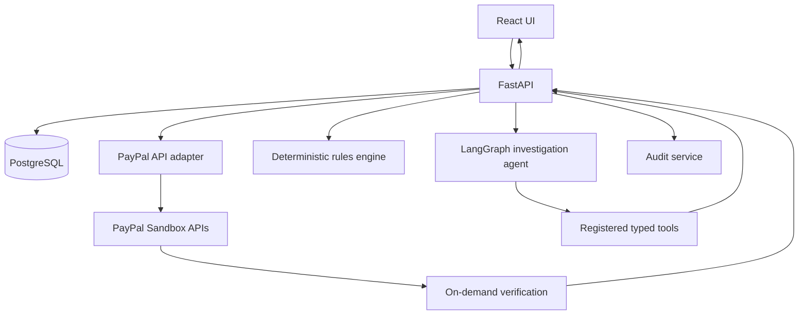

# 02 — Architecture and Workflows

## Logical components
- React + TypeScript web client.
- FastAPI application/API layer.
- Authentication and merchant authorization.
- PayPal adapter for server-side Orders and Payments API operations.
- On-demand payment verification service.
- PostgreSQL persistence via SQLAlchemy and migrations.
- Deterministic rules/reconciliation service.
- Investigation service that assembles evidence.
- LangGraph orchestration with registered tools.
- Audit service.
- CSV import service with provenance metadata.
- AG Grid AG Studio UI integration, subject to current SDK verification.

## Main payment flow
1. Client requests checkout for a local order.
2. Backend validates order ownership and amount, creates PayPal order.
3. Client approves using the PayPal JS SDK.
4. Backend captures using server-side credentials.
5. Backend validates response shape and persists capture details.
6. The merchant can request a payment-status refresh at any time. The backend calls the PayPal API directly, validates the response, and updates local state only through valid transitions.
7. Local state is reconciled using authoritative PayPal API responses; do not assume a local status is current without checking.

## Investigation flow
1. User chooses an issue or asks a question.
2. Agent identifies required evidence.
3. Registered tool validates user/merchant scope and retrieves records.
4. Deterministic service compares IDs, status, currency, amount, and event sequence.
5. Agent summarizes findings using tool results only.
6. UI displays evidence references and uncertainties.
7. If action is proposed, create a pending action record; do not execute yet.

## Payment verification flow
1. Merchant requests a status refresh for a captured payment.
2. Backend authenticates the user and confirms the payment belongs to the merchant.
3. Backend retrieves the capture ID from the local payment record.
4. Backend calls PayPal's Payments API to get the current capture status.
5. Backend validates the provider response.
6. Backend compares provider data with local records and updates state only through valid transitions.
7. Backend records the check and its outcome in the audit history.
8. Backend returns the result to the frontend, including last verification time.

If the provider cannot be reached, the local status is not changed and the failure is recorded. PayPilot AI does not receive automatic PayPal event notifications in this MVP.

## Approved action flow
1. User opens proposed action and sees amount, currency, target capture, reason, and risk.
2. User explicitly approves or rejects.
3. Backend checks role, ownership, action state, eligibility, currency, amount, and idempotency key.
4. Backend calls provider API.
5. Persist provider result and audit event.
6. If provider outcome is ambiguous due to timeout, mark as `outcome_unknown` and reconcile before retrying.

## Data ingestion flow
CSV upload → validate file size/type/columns → preview rows → show errors → merchant confirms → normalize fields → deduplicate using documented source keys → store source/provenance → run matching rules. CSV data must never be relabelled as provider-verified.

## Mermaid overview

