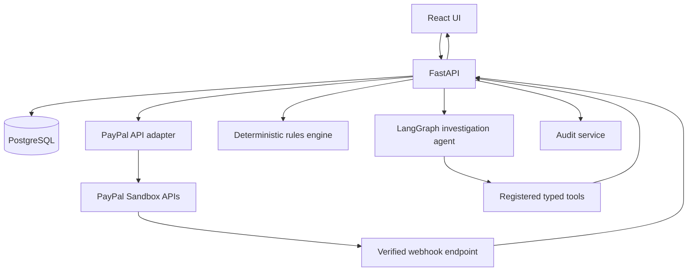

# 02 — Architecture and Workflows

## Logical components
- React + TypeScript web client.
- FastAPI application/API layer.
- Authentication and merchant authorization.
- PayPal adapter for server-side Orders and Payments API operations.
- Webhook endpoint and verification service.
- PostgreSQL persistence via SQLAlchemy and migrations.
- Deterministic rules/reconciliation service.
- Investigation service that assembles evidence.
- LangGraph orchestration with registered tools.
- Audit service.
- CSV import service with provenance metadata.
- AG Grid AG Studio UI integration, subject to current SDK verification.

## Main payment flow
1. Client requests checkout for a local order.
2. Backend validates order ownership and amount, creates PayPal order.
3. Client approves using the PayPal JS SDK.
4. Backend captures using server-side credentials.
5. Backend validates response shape and persists capture details.
6. PayPal webhook endpoint receives an event, verifies its signature, stores event ID and payload fields needed for the app, and processes it idempotently.
7. Local state is reconciled using authoritative API responses and verified events; do not assume webhook arrival order.

## Investigation flow
1. User chooses an issue or asks a question.
2. Agent identifies required evidence.
3. Registered tool validates user/merchant scope and retrieves records.
4. Deterministic service compares IDs, status, currency, amount, and event sequence.
5. Agent summarizes findings using tool results only.
6. UI displays evidence references and uncertainties.
7. If action is proposed, create a pending action record; do not execute yet.

## Approved action flow
1. User opens proposed action and sees amount, currency, target capture, reason, and risk.
2. User explicitly approves or rejects.
3. Backend checks role, ownership, action state, eligibility, currency, amount, and idempotency key.
4. Backend calls provider API.
5. Persist provider result and audit event.
6. If provider outcome is ambiguous due to timeout, mark as `outcome_unknown` and reconcile before retrying.

## Data ingestion flow
CSV upload → validate file size/type/columns → preview rows → show errors → merchant confirms → normalize fields → deduplicate using documented source keys → store source/provenance → run matching rules. CSV data must never be relabelled as provider-verified.

## Mermaid overview

