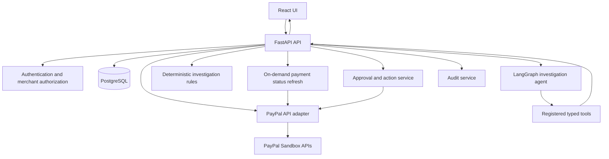

# PayPilot AI
## Project Specification & Claude Build Handbook

**Tagline:** The Payment Detective  
**Project type:** PayPal AI Hackathon application  
**Document status:** Revised for the webhook-free MVP

---

## 1. Executive Summary

PayPilot AI is an AI-assisted payment investigation and safe-resolution application for merchants. It helps merchants investigate why an order and payment record disagree, why a payment attempt failed or was cancelled, whether a local record is stale, or what the available records show about a refund.

PayPilot AI is not a generic financial chatbot and is not merely a dashboard. It follows an evidence-led workflow:

1. Detect or receive a payment issue.
2. Retrieve relevant order and payment records.
3. Check current provider information on demand when needed.
4. Run deterministic comparisons and validation rules.
5. Explain verified evidence, uncertainties, and possible causes.
6. Recommend a next step.
7. Require an authorized human to approve consequential actions.
8. Execute only supported and validated actions.
9. Record results in the application's audit history.

**Current product decision: PayPal webhooks are not part of the MVP.** PayPal status changes are checked through appropriate PayPal APIs when the merchant initiates a refresh or investigation. The application does not claim to receive automatic PayPal event notifications or to provide continuous real-time monitoring.

## 2. Problem, Users, and Value Proposition

### Primary users

- Merchant owners who need to understand and resolve payment issues.
- Operations or customer-support staff who investigate customer payment questions.
- Workspace administrators who manage access and application configuration.

### Problem

Payment investigations often require a merchant to compare the local order, provider payment details, amounts, currencies, and available status information manually. This can be slow and error-prone, especially when the local system's status does not agree with the provider's current status.

### Value proposition

PayPilot AI shortens the path from a payment question to an evidence-backed investigation and safe next step. It shows which facts have been verified, which records support them, and what remains uncertain.

### Example

A merchant asks: “Why is order #1042 still showing as unpaid?” PayPilot AI retrieves the local order, fetches relevant PayPal order/capture information where available, compares identifiers/status/amount/currency, explains the mismatch, and recommends a next step. It must not assume the payment succeeded solely because a frontend callback says so.

## 3. Hackathon Fit

The project must use the PayPal Developer Platform through the free Sandbox environment and integrate an AI tool, model, or platform. PayPal must be central to the product's functioning workflow.

### Core integration

- PayPal Sandbox checkout and order creation/capture.
- Server-side validation and persistence of provider responses.
- On-demand retrieval of available PayPal order/capture status for investigation.
- Eligible Sandbox refund workflow with human approval, if verified and supported by the implementation.

### AI integration

The AI investigation agent uses registered backend tools to retrieve application records and interpret deterministic checks. It cannot execute payments directly, authorize itself, access secrets, or run arbitrary SQL.

### Planned sponsor tools

- **AG Grid AG Studio:** intended for a meaningful interactive investigation/analytics experience, subject to actual SDK access and implementation verification.
- **APIMatic:** development support for understanding and implementing APIs, if available under the hackathon offer.
- **Postman:** API testing and collections.
- **Render:** hosting candidate for the deployed application.

Sponsor tool use and sponsor-prize eligibility are different. Check current sponsor-specific rules before claiming eligibility. Do not claim AG Studio is integrated unless its actual SDK/product is genuinely used and tested.

## 4. MVP Goals

1. A merchant can sign in to a protected workspace.
2. A merchant can create a local order and initiate PayPal Sandbox checkout.
3. The backend creates a PayPal order using server-side credentials.
4. The buyer approves checkout through the PayPal JavaScript SDK.
5. The backend captures the payment and validates the actual provider response.
6. Local order/payment records persist provider references, amount, currency, status, and timestamps.
7. The merchant can request an on-demand PayPal status refresh when appropriate.
8. A deterministic rules engine flags testable inconsistencies.
9. The merchant can open an investigation and inspect a timeline made from local records, payment checks, and audit entries.
10. The AI agent investigates through controlled, typed backend tools.
11. Findings include evidence references, known facts, uncertainties, and a recommended next step.
12. The merchant can prepare and approve a supported Sandbox refund, subject to eligibility and backend authorization checks.
13. Sensitive actions and investigation outcomes are stored in an audit trail.
14. External CSV data can be imported and clearly marked as imported/unverified.
15. The app provides setup instructions and a repeatable demonstration path.

## 5. Explicit Non-Goals

The MVP does not aim to:

- Receive or process PayPal webhooks.
- Require a PayPal Webhook ID or webhook listener URL.
- Claim automatic or real-time detection of external payment changes.
- Connect live to every marketplace or payment provider.
- Access a merchant's complete live PayPal account history without a separate authorized integration.
- Execute refunds automatically without approval.
- Claim fraud detection certainty or provide financial guarantees.
- Let an AI model run arbitrary SQL, shell commands, or unbounded requests.
- Aggregate unlike currencies without an explicit conversion process.
- Replace accounting or payment-provider platforms.

## 6. Architecture

### Technology stack

- **Frontend:** React + TypeScript + Vite.
- **Styling/UI:** existing Tailwind CSS and component system where compatible.
- **Backend:** Python + FastAPI + Pydantic.
- **Database:** PostgreSQL, with Supabase as the planned hosted database.
- **ORM/migrations:** SQLAlchemy + Alembic.
- **AI orchestration:** LangGraph with Gemini API, subject to the existing implementation and current model/tool support.
- **Payments:** PayPal JavaScript SDK + PayPal Orders API + relevant Payments API operations.
- **Analytics sponsor:** AG Grid AG Studio if the actual integration can be verified.
- **Development/testing:** Postman and APIMatic where available.
- **Hosting:** Render, subject to plan limits and current service availability.

Preserve compatible existing code and dependencies. Do not replace the architecture without a clear technical reason.

### Logical components

1. React web client.
2. FastAPI API and authentication layer.
3. Merchant authorization service.
4. PayPal adapter for server-side order create/capture, order/capture retrieval, and supported refunds.
5. PostgreSQL persistence using SQLAlchemy and Alembic.
6. Deterministic issue detection and reconciliation service.
7. Investigation service that assembles evidence.
8. LangGraph agent with a registry of typed tools.
9. Approval/action service.
10. Audit service.
11. CSV import service with provenance metadata.
12. AG Grid AG Studio experience, only if genuinely integrated.

### Architecture diagram

## 7. Main Payment Flow — Without Webhooks

1. The client asks to check out a local order.
2. The backend authenticates the merchant and validates order ownership and amount.
3. The backend creates the PayPal order using server-side credentials.
4. The buyer approves checkout using the PayPal JavaScript SDK.
5. The backend captures the payment.
6. The backend validates the actual provider response and persists capture details.
7. The frontend displays the status returned by the backend.
8. When a merchant needs a current status, the frontend calls the refresh endpoint.
9. The backend retrieves the appropriate PayPal order/capture information, validates it, compares it with the local record, and stores the check outcome and `last_verified_at` timestamp.
10. If the provider cannot be reached or the outcome is ambiguous, the application preserves the last known status and clearly reports that refresh did not complete.

No webhook event is required for any step in this MVP.

### Status-refresh safety

- Authenticate the requester and enforce merchant ownership.
- Use provider IDs stored by the backend; do not trust arbitrary IDs supplied by the browser.
- Validate response status, amount, currency, and identifiers as applicable.
- Apply only valid state transitions.
- Record the result and time of each status check.
- Do not mark a payment successful from an unverified client callback.
- Do not blindly repeat a capture or refund after an ambiguous timeout. Reconcile the provider state first.

## 8. Investigation Flow

1. The user opens a flagged issue or asks a question in natural language.
2. The agent identifies the records and checks required.
3. Registered tools validate arguments and merchant scope.
4. Tools retrieve local order/payment data and, when appropriate, refresh current PayPal information through the backend.
5. Deterministic rules compare available IDs, status, amount, currency, timestamps, and source provenance.
6. The agent summarizes only what the tool results support.
7. The UI displays facts, evidence references, uncertainties, and a recommended next step.
8. If a financial action is suitable, the agent may create a pending proposal; it must not execute the action.

### Supported issue types

- Local order/payment status mismatch.
- Amount or currency mismatch.
- Payment attempt failed or cancelled according to the recorded provider response.
- Imported order/payment record cannot be matched confidently.
- Duplicate CSV import or repeated local processing.
- Refund record/status inconsistency where provider information is available.
- Provider refresh could not be completed or available data is stale.

A flagged issue is an investigation lead, not proof of fraud or loss.

## 9. Approved Action Flow

1. The merchant opens a proposed action and sees the relevant investigation, target capture, amount, currency, reason, and evidence.
2. The merchant explicitly approves or rejects.
3. The backend checks role, merchant ownership, current action state, payment eligibility, amount, currency, and duplicate-request protection.
4. If approved and eligible, the backend calls the appropriate provider API.
5. The backend validates the response and records the result and audit event.
6. If a provider timeout makes the outcome ambiguous, mark the outcome as unknown and check current provider state before retrying.

The AI must never approve itself or call the refund endpoint directly.

## 10. Data Provenance and Imports

Every record must indicate its source/trust state, for example:

- `paypal_api` — retrieved directly from a PayPal API.
- `local_application` — created or maintained by this application.
- `merchant_csv_import` — imported by a merchant and not independently verified by PayPal.
- `test_fixture` — synthetic scenario, visibly labelled as a test fixture.

Do not claim that CSV/imported/fixture data came from PayPal.

### CSV requirements

- Provide documented templates and clearly labelled sample files.
- Validate size, type, required columns, amount, currency, and date fields.
- Preview rows and errors before committing.
- Preserve source identifiers, original row number, uploader, and import timestamp.
- Deduplicate repeated imports using documented source keys.
- Do not match records solely because their amounts are equal.
- Show imported provenance to users and the AI agent.

Marketplace connectors such as Amazon, Flipkart, Shopify, WooCommerce, and POS platforms are future extensions unless actually implemented and tested. CSV import is not a live platform integration.

## 11. Database Model

Keep existing useful tables and migration history. Adapt names to the repository if equivalent tables already exist.

### `merchants`
- `id` UUID primary key
- `name`
- optional `default_currency`
- `created_at`

### `users`
- `id`, `merchant_id`, `email`, `password_hash` or identity-provider subject, `role`, `created_at`, `disabled_at`

### `orders`
- `id`, `merchant_id`, `source_type`, `external_order_id`, `currency`, `total_amount`, `status`, `created_at`, `updated_at`, `provenance`, `metadata_json`
- Prevent duplicate source order IDs within the relevant merchant/source scope.

### `payment_attempts`
- `id`, `merchant_id`, `order_id`, `provider`, `provider_order_id`, `capture_id`, `currency`, `amount`, `status`, `provider_status`, `created_at`, `updated_at`, `provenance`, `last_verified_at`
- One order may have multiple payment attempts.

### `payment_checks`
- `id`, `merchant_id`, `payment_attempt_id`, `checked_at`, `result`, `provider_status`, `amount`, `currency`, `error_code` (sanitized), `details_redacted_json`
- Stores on-demand status-check outcomes. It does not represent a webhook event.

### `investigations`
- `id`, `merchant_id`, `created_by`, `issue_type`, `status`, `title`, `order_id`, `payment_attempt_id`, `priority`, `opened_at`, `resolved_at`

### `investigation_findings`
- `id`, `investigation_id`, `finding_type`, `severity`, `summary`, `evidence_refs_json`, `facts_json`, `uncertainties_json`, `recommendation`, `created_at`, optional `model_version`

### `proposed_actions`
- `id`, `merchant_id`, `investigation_id`, `action_type`, `target_capture_id`, `currency`, `amount`, `reason`, `status`, `proposed_by`, `approved_by`, `approved_at`, `executed_at`, `provider_request_id`, `idempotency_key`, `outcome_json`

### `audit_events`
- `id`, `merchant_id`, `actor_user_id` (nullable for system events), `action`, `target_type`, `target_id`, `timestamp`, `outcome`, `correlation_id`, `details_redacted_json`

### Imports
Track uploaded file metadata, source label, uploader, import time, validation result, row count, and row-level source references. Imported rows remain unverified unless matched through an independently supported source of evidence.

### Money and timestamps

- Use `Decimal` or integer minor units with explicit currency metadata.
- Validate currency precision and provider-supported currencies.
- Store timestamps in UTC and render them in the user's locale.
- Never add different currencies without an explicit conversion policy and exchange-rate provenance.

## 12. Backend API Design

Adapt endpoint paths to the existing implementation; avoid duplicating existing routes.

### Authentication
- `POST /api/auth/login`
- `POST /api/auth/logout` if required by the auth method
- `GET /api/auth/me`

### Orders and payments
- `POST /api/orders`
- `GET /api/orders`
- `GET /api/orders/{order_id}`
- `POST /api/paypal/orders/{order_id}/create`
- `POST /api/paypal/orders/{order_id}/capture`
- `GET /api/payments`
- `GET /api/payments/{payment_id}`
- `GET /api/payments/{payment_id}/timeline`
- `POST /api/payments/{payment_id}/refresh-status`

### Investigations
- `GET /api/investigations`
- `POST /api/investigations`
- `GET /api/investigations/{id}`
- `POST /api/investigations/{id}/run`
- `POST /api/ai/investigate`

### Actions and audit
- `POST /api/investigations/{id}/proposed-actions`
- `POST /api/proposed-actions/{id}/approve`
- `POST /api/proposed-actions/{id}/reject`
- `GET /api/audit-events`

### Imports and health
- `POST /api/imports/preview`
- `POST /api/imports/confirm`
- `GET /api/imports/{id}`
- `GET /api/health`

All endpoints must enforce authentication, merchant scope, typed validation, consistent errors, pagination where appropriate, and request/correlation IDs. Do not create or retain webhook routes in the webhook-free MVP.

## 13. AI Agent Specification

### Registered tools

1. `get_order_details(order_id)`
2. `get_payment_details(payment_attempt_id or stored provider reference)`
3. `refresh_payment_status(payment_attempt_id)` — on-demand backend refresh using stored provider references.
4. `compare_order_payment(order_id, payment_attempt_id)`
5. `find_related_records(strictly bounded filters)`
6. `run_payment_rules(order_id or payment_attempt_id)`
7. `get_investigation_summary(investigation_id)`
8. `prepare_resolution(investigation_id, action_type, parameters)` — creates a pending proposal only.

Each tool must validate its arguments and enforce authenticated merchant ownership. The model must not get raw database credentials or arbitrary SQL execution.

### Agent orchestration

Use a bounded LangGraph workflow:

1. Parse the question/issue.
2. Select relevant approved tools.
3. Execute tool calls with validated arguments.
4. Evaluate whether evidence is sufficient.
5. If needed, make another bounded tool call.
6. Produce structured, evidence-grounded output.
7. Persist the finding and relevant audit metadata.

### Output schema

- `summary`: concise explanation.
- `issue_type`: controlled enum.
- `facts`: facts and evidence references.
- `uncertainties`: missing or inconclusive evidence.
- `recommendation`: next step.
- `proposed_action`: optional pending proposal ID.
- `needs_human_review`: boolean.

Every transaction-specific factual claim must be supported by returned tool evidence. When data is missing, stale, or unavailable, the agent must say so.

## 14. UI/UX Requirements

Build a trustworthy merchant operations interface, not a chatbot-only landing page.

### Screens

1. **Overview:** Sandbox payment activity, open investigations, issue counts, and recent checks.
2. **Investigations:** filterable queue with issue, severity, order/payment reference, status, and age.
3. **Payment details:** order/capture identifiers, amount/currency, local status, latest provider check, source/provenance, and activity timeline.
4. **AI investigation copilot:** question input, tool-backed findings, evidence, uncertainty, and recommendation.
5. **Approvals:** proposed action details and explicit approve/reject controls.
6. **Audit history:** searchable record of consequential actions and investigation outcomes.
7. **Integrations/settings:** safe configuration status, PayPal Sandbox status, AI configuration status, database health where safe, and instructions for setting secrets in environment configuration.
8. **Imports:** CSV upload, preview, validation, import history, and provenance.

### AG Grid AG Studio

Verify the current sponsor documentation, SDK/package, access, and licensing before integrating. Use it substantively if feasible for the investigation dashboard or analytics. Do not claim its usage unless it is genuinely integrated and tested. A fallback table/chart may be used if access is unavailable, but the limitation must be documented.

### UX standards

- Clearly labelled loading, empty, success, and error states.
- Status text as well as colour.
- Clear “Refresh payment status” action.
- Show the time of last successful verification.
- Distinguish stale local status from newly verified provider information.
- Never display success before the backend confirms the operation.
- Do not expose secrets in settings or client-side state.

## 15. Environment Configuration

### Local development

Use the existing root/backend `.env` file that contains the user's local values, based on how the current repository loads settings. Inspect the current configuration paths and do not overwrite the existing file.

- Ensure `.env` is ignored by Git.
- Never print its contents or copy secrets into documentation, tests, screenshots, or generated artifacts.
- Do not include `.env` in a ZIP or public repository.
- Keep `.env.example` only as an optional sanitized template with placeholders; it must not be a runtime dependency for the local application.
- If a required setting is missing, report only the variable name, not its value.

### Expected runtime variables

Use the repository's actual names where already established. Typical settings may include:

- `DATABASE_URL`
- `APP_SECRET_KEY`
- `PAYPAL_CLIENT_ID`
- `PAYPAL_CLIENT_SECRET`
- `PAYPAL_BASE_URL` (Sandbox by default)
- `GEMINI_API_KEY`
- `FRONTEND_ORIGIN`

**Do not require `PAYPAL_WEBHOOK_ID`. There is no webhook functionality in the current MVP.**

### Production deployment

Configure equivalent values directly in Render's environment settings and configure the hosted PostgreSQL connection securely. Do not upload the local `.env` file or commit secrets. Keep local and production secrets separate.

## 16. Security and Reliability

- Keep PayPal and AI secrets on the server.
- Hash passwords or use a securely configured identity provider.
- Enforce merchant-level isolation on every read and action.
- Check permissions for approvals and refunds.
- Use correct CORS/session/CSRF handling for the selected auth strategy.
- Validate requests and upload limits.
- Rate-limit expensive AI endpoints where appropriate.
- Use idempotency protections for financial operations.
- Record audit events for approvals, rejection, refunds, imports, and configuration changes.
- Redact secrets and unnecessary personal data from logs.
- Guard CSV exports against formula injection.
- Use safe provider retry/reconciliation behaviour when an outcome is ambiguous.
- Do not depend on webhooks for security, correctness, or state updates.

## 17. Testing Plan

### Unit tests

- Amount/currency comparisons.
- Payment status transition rules.
- Status-refresh failures and stale status handling.
- CSV validation and repeat-import deduplication.
- AI schema/evidence-reference validation.
- Merchant authorization.
- Proposed-action state machine and duplicate requests.

### Integration tests

- PayPal Sandbox create/capture using configured credentials.
- Direct order/capture status refresh.
- Database persistence and migrations.
- AI tool execution against seeded records.
- Refund validation and supported Sandbox refund path.

No webhook-specific tests or setup are required for the current MVP.

### End-to-end demo test

1. Sign in.
2. Complete a real PayPal Sandbox checkout.
3. Confirm the capture and local persisted payment record.
4. Refresh payment status through PayPal's API.
5. Open a clearly labelled reproducible test investigation based on local test data or a controlled mismatch scenario.
6. Ask the AI to investigate.
7. Inspect evidence references and uncertainties.
8. Prepare and approve/reject a supported action; run an eligible Sandbox refund only if its preconditions are met.
9. Verify the resulting state and audit record.

## 18. Deployment Plan

1. Confirm local backend and frontend startup.
2. Run migrations against the target PostgreSQL database.
3. Configure Supabase PostgreSQL and test its connection.
4. Deploy FastAPI as a Render web service.
5. Deploy React as a Render static site or another appropriate frontend host.
6. Configure allowed frontend origin and environment variables.
7. Test health endpoints, authentication, database reads/writes, and the PayPal Sandbox API flow on the deployed version.
8. Verify that refresh status works over the deployed backend.
9. Run the full demo checklist against the deployed app.
10. Document free-tier sleep/cold-start limitations if applicable.

No webhook URL, Webhook ID, or webhook listener configuration is needed for this version.

## 19. Hackathon Submission Checklist

Use the official contest rules as the source of truth and check the current submission page for any updates.

- [ ] PayPal Developer Sandbox integration is central and genuinely tested.
- [ ] AI model/platform is meaningfully integrated.
- [ ] App runs on its intended platform.
- [ ] Detailed English project description is ready.
- [ ] Working demo URL or clear repository setup instructions are provided.
- [ ] Public repository contains source, assets, setup instructions, and an appropriate open-source license.
- [ ] Demo/Sandbox instructions are safe to share and contain no private credentials.
- [ ] Public YouTube demo is under 3 minutes, shows the real app, and uses English or an English translation.
- [ ] No static prototype is represented as a working product.
- [ ] Sponsor-prize claims are based on the current sponsor rules and genuine implementation.
- [ ] `.env` and secrets are absent from the public repository.

### Suggested demo narrative (target 2:40)

- 0:00–0:20 — Explain the payment investigation problem.
- 0:20–0:55 — Complete PayPal Sandbox checkout and show persisted payment data.
- 0:55–1:20 — Show the on-demand status refresh and a labelled investigation case.
- 1:20–2:00 — Ask the AI to investigate and show tool-backed findings.
- 2:00–2:25 — Review an eligible proposed action or demonstrate the safe approval/rejection workflow.
- 2:25–2:40 — Summarize the PayPal + AI integration and impact.

## 20. Implementation Roadmap

### Phase 0 — Repository inspection
- Inspect the existing repository and preserve useful work.
- Check startup/configuration paths, current `.env` loading, dependencies, Git status, and tests.
- Confirm `.env` is ignored and secrets are not tracked.

### Phase 1 — Foundation and configuration
- Make local settings load from the existing `.env`.
- Establish or verify app startup, health endpoints, database connection, migrations, and tests.
- Keep `.env.example` optional and sanitized.

### Phase 2 — PayPal Sandbox payment
- Implement or verify order creation, buyer approval, capture, and persistence.
- Keep credentials backend-only.

### Phase 3 — On-demand payment verification
- Implement direct status-refresh endpoint using stored provider identifiers.
- Store each check in `payment_checks` or equivalent.
- Update the UI and audit history.

### Phase 4 — Deterministic investigation engine
- Define issue enums and rules.
- Implement investigation queue, transaction detail, evidence timeline, and test cases.

### Phase 5 — AI investigator
- Implement typed tool registry and bounded LangGraph flow.
- Validate findings and evidence references.
- Add failure/timeout handling and insufficient-evidence responses.

### Phase 6 — UI and sponsor integration
- Complete overview, investigations, payment details, AI copilot, approvals, audit, settings, and imports screens.
- Verify and implement AG Grid AG Studio where feasible.

### Phase 7 — Approved actions
- Implement proposal/approve/reject state machine.
- Add eligible Sandbox refund flow only after verifying the official API requirements.
- Revalidate ownership, permission, payment state, amount, currency, and idempotency.

### Phase 8 — Deployment and submission
- Deploy frontend/backend and hosted PostgreSQL.
- Run end-to-end tests.
- Publish root README and license.
- Prepare the three-minute-or-less demo video and verify submission requirements.

### Scope rule

The PayPal Sandbox investigation flow and on-demand status verification take priority over marketplace API breadth and advanced dashboard features. If time is short, postpone additional connectors and sponsor extras rather than compromising payment correctness, AI evidence grounding, or demo reliability.

## 21. Assumptions and Risks

### Decisions already made

- Product: PayPilot AI — The Payment Detective.
- Focus: payment investigation and safe resolution.
- Webhooks: removed from the MVP; no webhook ID required.
- Local runtime configuration: use the existing `.env` file without revealing or committing its contents.
- Production configuration: use hosting-provider environment settings.
- Data model: global-ready currency and provenance handling, but PayPal-first MVP.
- AI: controlled tools, backend facts, explicit uncertainty, human approval for consequential operations.
- External marketplaces: future integration targets; CSV data is clearly labelled and not treated as live provider data.

### Risks and mitigations

- **Sandbox/API credentials unavailable:** implement a clear setup check and continue testing non-provider code; never pretend API calls succeeded.
- **Provider timeout:** preserve last known status, mark refresh as inconclusive, and reconcile before repeating a financial action.
- **AI hallucination:** use typed tools, deterministic checks, evidence references, and an explicit uncertainty field.
- **Duplicate financial actions:** action state machine, idempotency, and backend revalidation.
- **Sponsor SDK access blocked:** document the issue and do not claim a sponsor integration that was not implemented.
- **Scope creep:** protect the end-to-end PayPal payment and investigation flow as the release criterion.

## 22. Instructions for Claude Code

Before editing, inspect the actual repository and compare its state with this specification. Preserve working functionality and update existing files incrementally.

- Remove webhook implementation and configuration dependencies from the current MVP.
- Use the existing `.env` for local runtime configuration; do not overwrite it or expose its contents.
- Keep `.env.example` as an optional placeholder-only template, not as a required runtime file.
- Do not require `PAYPAL_WEBHOOK_ID`.
- Implement direct PayPal status refresh and make limitations visible.
- Run tests and frontend build after each phase.
- Report files changed, commands run, tests passed/failed, and remaining blockers.
- Verify the current official documentation for provider APIs and sponsor integrations.
- Do not claim anything is working unless tested.
- Do not deploy publicly until critical authorization, secret handling, payment-state, and refund-safety checks pass.
